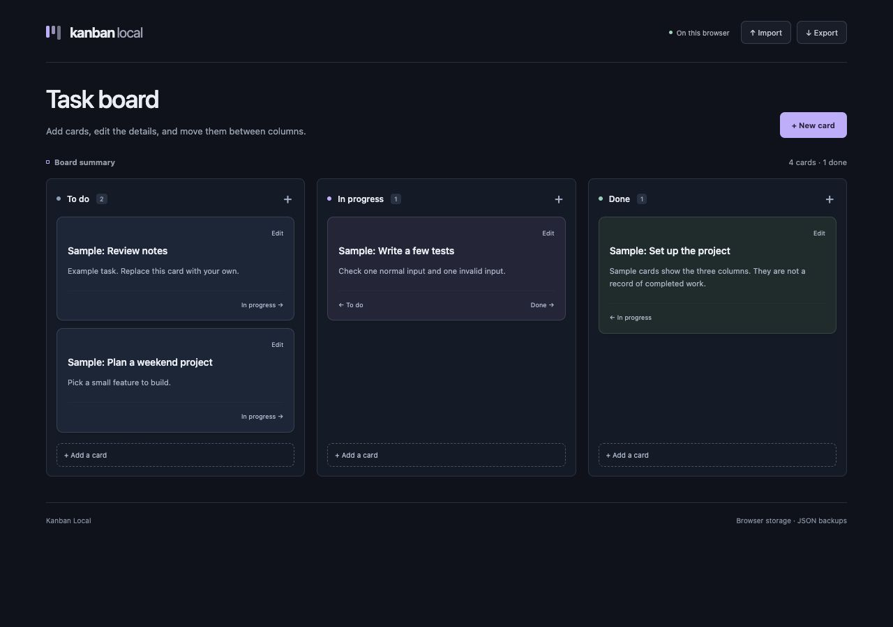

# Kanban Local

A React task board with three columns: **To do**, **In progress**, and **Done**. This is a small state-management and file-handling project. Cards have a title and description, and the board can be saved to a JSON file.



## Try it

Use Node.js 22.12 or newer and npm.

```sh
npm ci
npm run dev
```

Open the address Vite prints. The four starting cards are labeled samples. Add a card such as **Review lecture notes**, use its move buttons to change columns, or select **Edit** to change its details or delete it. Move buttons are usable from the keyboard too.

Changes are saved in this browser under `kanban-local.v1`. There is no server or account. Use one tab at a time: open tabs do not sync, and the last save wins. Clearing browser data removes the board. If saving fails, a warning appears and you can export the board still held in memory.

## Moving a board between browsers

**Export** downloads `kanban-board.json`. **Import** checks the whole file and asks before replacing the current board. You can export the current board from that confirmation dialog first. Invalid or canceled imports leave it alone.

A one-card backup looks like this:

```json
{
  "version": 1,
  "cards": [
    {
      "id": "notes",
      "title": "Review lecture notes",
      "description": "Work through the examples again.",
      "column": "todo"
    }
  ]
}
```

Only these fields are accepted. Columns are `todo`, `doing`, or `done`; IDs must be unique and contain 1–64 letters, numbers, underscores, or hyphens. Titles allow 80 characters, descriptions allow 1,000, and a board allows 200 cards. The file limit is 1 MB.

The validation and card operations live in `src/board.js`; `src/main.jsx` handles dialogs, browser storage, and files. Validating before setting React state avoids replacing half the board when a later card in an import is invalid.

## Development

```sh
npm test
npm run build
npm run preview
```

The seven Node tests exercise card changes, JSON round trips, and rejected imports, including duplicate IDs and a file containing both valid and invalid cards. GitHub Actions runs tests and a production build on Node 22 and 24.

The board uses buttons instead of drag-and-drop. There is no custom card ordering, undo, due dates, or multiple-board support. Browser-account sync does not carry this data to another device; JSON backups are the way to move it. Unreadable saved data opens the sample board and is only replaced after a change.

[MIT license](LICENSE) · Kenneth Park
